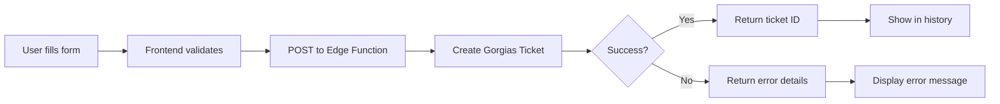

# Gorgias Ticket Sender Dashboard

## Overview

A clean web dashboard for creating support tickets and sending outbound emails through Gorgias, with full control over To, CC, and BCC recipients.

---

## Dashboard Preview

### Form Layout
- **To** field — Required, comma-separated emails
- **CC** field — Optional, same format  
- **BCC** field — Optional, same format
- **Subject** — Required text input
- **Body** — Required textarea with rich formatting
- **Send Ticket** button with loading state

### Validation
- Email format validation on all recipient fields
- At least one "To" recipient required
- Subject and body cannot be empty
- Clear inline error messages

### After Sending
- Success message with clickable ticket ID
- Session history table showing recent sends (To/CC/BCC counts, subject, status, timestamp)

---

## How It Works

---

## What Gets Built

### 1. Ticket Sender Page
- Modern dark theme matching your existing dashboard
- Responsive form with clear field labels
- Real-time email validation as you type
- Loading spinner while sending
- Success/error feedback
- Session-based send history (clears on refresh)

### 2. Send Ticket Backend
- New Edge Function: `send-ticket`
- Accepts: `{ to[], cc[], bcc[], subject, body }`
- Creates Gorgias ticket with proper email source fields
- Handles rate limiting with automatic retry
- Returns ticket ID or detailed error

---

## Configuration

Two additional secrets needed (you already have the Gorgias API credentials):

| Secret | Purpose |
|--------|---------|
| `GORGIAS_SENDER_EMAIL` | Email of the Gorgias agent/user shown as sender |
| `GORGIAS_FROM_ADDRESS` | Your connected Gorgias email integration address (must match an active integration) |

---

## Email Sending Details

The ticket will be created with:
- **Customer**: First "To" recipient (required by Gorgias)
- **Channel**: Email
- **From Agent**: Yes (outbound message)
- **Source Fields**: Proper To/CC/BCC arrays for email routing
- **Body**: Both HTML and plain text versions

**Important**: The `GORGIAS_FROM_ADDRESS` must be an email address connected to your Gorgias account as an email integration, or the email won't actually send.